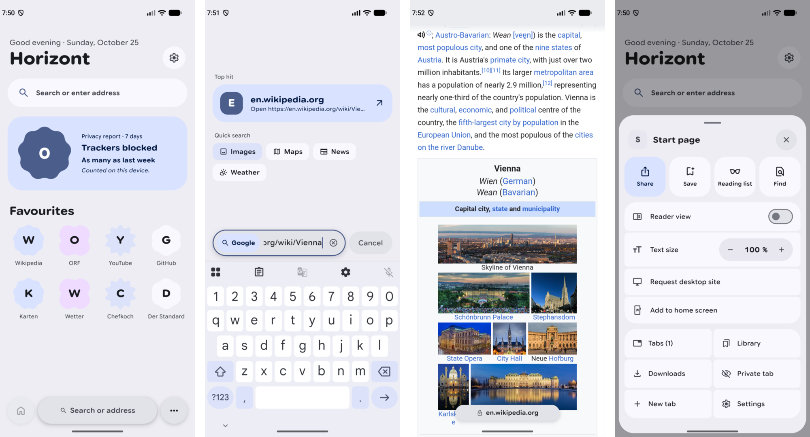
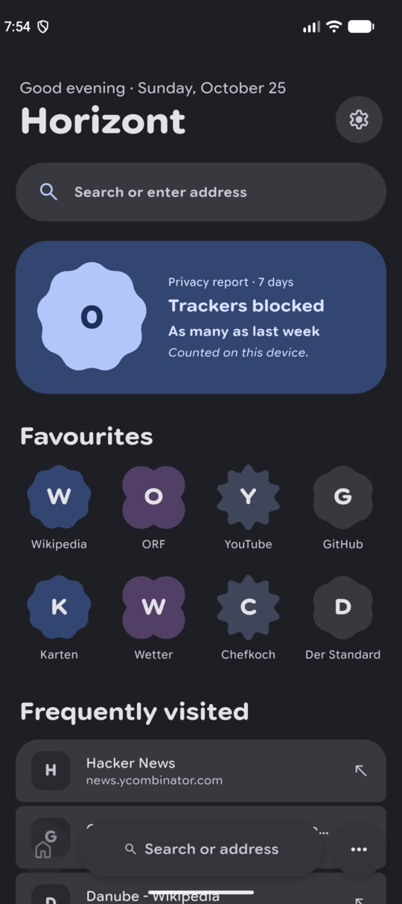
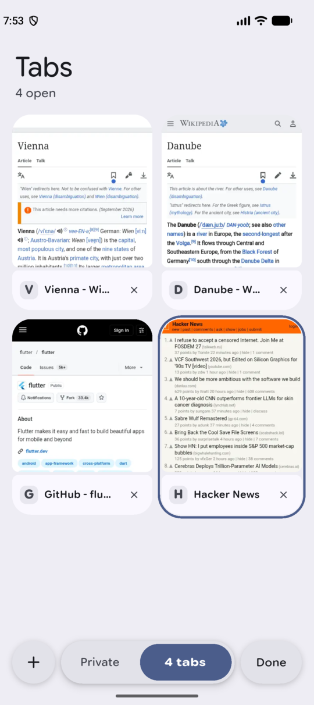
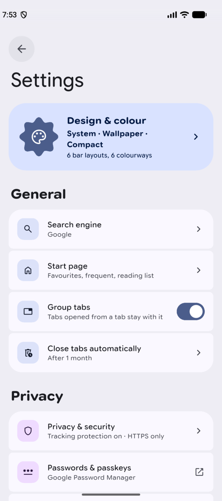
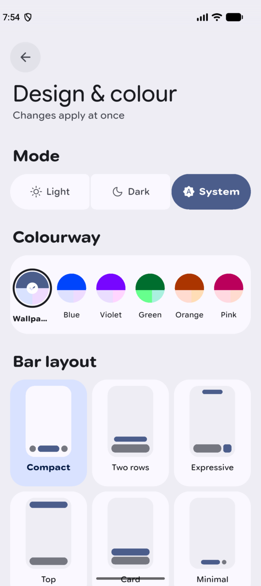
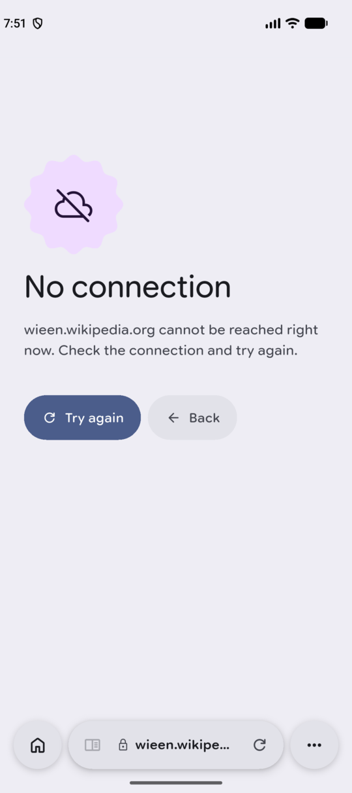
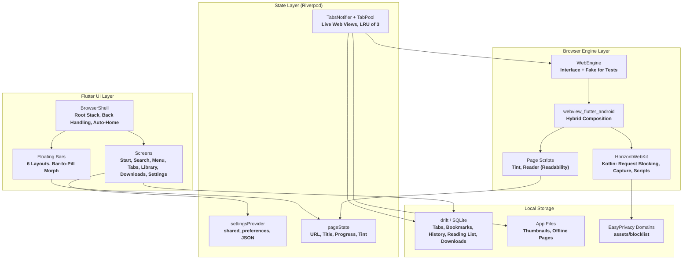

<div align="center">
  
  <h1>Horizont</h1>
  <p><strong>A mobile browser for Android on the system web view, with floating bars that become a pill, a start page that is not a list of links, and tracker blocking that stays on the device.</strong></p>

  <p>
    
    
    
    
    
    
  </p>
</div>

---



---

## What It Is

**Horizont** is a browser for **Android**, written in **Flutter**. Pages are drawn by the **Android System WebView**; everything around them (bars, tabs, search, menu, library, settings) is Flutter and follows **Material 3 Expressive**: spring motion, morphing shapes and **Material You** colours from your wallpaper.

It was designed for one phone, a **Pixel 10 Pro**, and built from an HTML prototype in `referenz/`. The layout, spacing and radii of that prototype are the source of truth; the plan is in [`docs/PLAN.md`](docs/PLAN.md), measurements and dead ends are in [`docs/spikes.md`](docs/spikes.md).

---

## Core Capabilities

- **Floating Bars:** The address bar floats over the page and shrinks to a small **pill** while you read. The bar and the pill are one surface that morphs, not a cross-fade. Six layouts: **Compact**, **Two rows**, **Expressive**, **Top**, **Card** and **Minimal**.
- **Status Bar Tint:** A script reads the page's colour (`theme-color`, header, or the top of the page) and tints the status bar to match. Tapping the status bar scrolls to the top.
- **Search Screen:** The field grows out of the address pill. It shows the top hit, **suggestions** from your search engine, history, and quick searches (Images, Maps, News, Weather). Engines: **Google**, **Ecosia**, **DuckDuckGo**, **Startpage**, **Bing**.
- **Start Page:** Greeting by time of day, a search pill, a **privacy report** (trackers blocked in seven days), favourites as **Material 3 Expressive shapes** that morph to a circle when pressed, and frequently visited sites. Each section can be switched off.
- **Menu Sheet:** Grows out of the menu button. Share, save, reading list, find in page, **reader view**, text size, desktop site, add to home screen, and entries for tabs, library, downloads, private tab and settings. Pull it down or fling it to close.
- **Tabs:** Overview with live thumbnails, tab groups (tabs opened from a tab stay with it), closing old tabs automatically, and restoring every tab with its picture after a restart. Only the last three web views are kept alive; the others are restored from their saved state.
- **Private Tabs:** Separate page, no history, optional **fingerprint lock** before they open.
- **Tracking Protection:** Requests to **47,024** tracker domains from the **EasyPrivacy** list are blocked in the web view before they leave the device. **HTTPS-only** mode is on by default. Counts are kept on the device.
- **Library:** Bookmarks, history grouped by day, and a **reading list** that keeps an offline copy of the page with a reading time estimate.
- **Downloads:** Handled by **background_downloader**, with a downloads page.
- **Design & Colour:** Light, dark or system; **Material You** from the wallpaper or one of five fixed colourways (**Blue**, **Violet**, **Green**, **Orange**, **Pink**); bars opaque or translucent.
- **Languages:** English and German. The app follows the system language.
- **Motion:** All movement runs on **springs** from the Material 3 Expressive tokens (`motor`). With "Remove animations" switched on, spatial springs become non-bouncing effect springs.

---

## Screens

| Start page, dark | Tabs | Settings | Design & colour |
| :---: | :---: | :---: | :---: |
|  |  |  |  |

An unreachable page shows an error screen with **Try again** and **Back** instead of the web view's default page:



---

## Architecture Overview

The root of the app is a `Stack`: the web view at the bottom, the start page over it when a tab has no address, and the floating bars on top. Screens are routes over that stack. State is **Riverpod**; the web view sits behind a `WebEngine` interface, so the tests run against a fake engine.



---

## Platform Support Matrix

| Platform | Target | Status |
| :--- | :--- | :--- |
| **Android** (**Pixel 10 Pro**, Android 17) | minSdk **31**, targetSdk **36**, portrait | ***Tested:*** the development device, release and profile builds, used by hand |
| **Android** (**Pixel_10** emulator, 120 Hz) | same | ***Tested:*** all screenshots in this README, the frame-time measurements in `docs/spikes.md` |
| **Other Android devices** | Android 12+ | ***Untested.*** Nothing in the code is Pixel-specific except a request for 120 Hz |
| **iOS, Linux, macOS, Windows** | none | ***Not available.*** The project has an `android/` runner only |

**What is checked, and how**

- ***Tested*** with **263** automated tests (`flutter test`): unit, drift migration, widget and golden tests at 412 x 915, light and dark, against the fake engine.
- ***Tested* by hand on the phone:** browsing, search, tabs and their restore, the menu, settings, scrolling, the status bar tint.
- ***Built*, not checked by hand on a device:** downloads, the reading list's offline copy, the fingerprint lock for private tabs.
- **Not checked at all:** TalkBack, 3-button navigation.
- **Release signing:** the release build is signed with the debug key. Nothing is published to a store.

---

## Design Tokens

| Token | Value |
| :--- | :--- |
| **Typeface** | **Google Sans Flex** (variable: `opsz`, `wdth`, `wght`, `GRAD`, `ROND`), bundled, SIL OFL |
| **Icons** | **Material Symbols** (`material_symbols_icons`) |
| **Shapes** | **MaterialShapes** from `material_ui`: cookie, clover, soft burst, flower; morph on press |
| **Springs** | `expressiveSpatialFast`, `expressiveSpatialDefault`, `expressiveEffectsDefault` from `motor` |
| **Tokens** | **`referenz/tokens.json`**, turned into `lib/theme/tokens.g.dart` by `tool/gen_tokens.dart` |

---

## Prerequisites & Installation

You need **Flutter 3.47.6** (**Dart 3.13.5**), the **Android SDK**, and a device or emulator running **Android 12 or newer**.

```bash
git clone https://github.com/tomsliikee/horizont.git
cd horizont
flutter pub get
flutter run
```

The drift database code (`lib/data/db/app_database.g.dart`), the localisations and the design tokens are checked in. Regenerate them only when you change the source:

```bash
dart run build_runner build --delete-conflicting-outputs
flutter gen-l10n
dart run tool/gen_tokens.dart
```

Do not run `dart format` on `lib/theme/tokens.g.dart`.

### Build

```bash
flutter build apk --release
```

Use `--profile` to measure frame times; debug builds are not representative. The build is signed with the debug key unless you add your own signing configuration.

### Tests and measurements

```bash
flutter analyze
flutter test
flutter test --update-goldens
flutter run --profile --dart-define=FRAME_STATS=true
```

**`FRAME_STATS=true`** prints build and raster times to the log (tag `flutter`). The measurements and the findings behind the performance work are in [`docs/spikes.md`](docs/spikes.md).

---

## Data Storage

| Data | Where | Format |
| :--- | :--- | :--- |
| **Settings** | `shared_preferences` | One JSON object; new keys have defaults, so old data stays readable |
| **Tabs, bookmarks, history, reading list, downloads, tracker counts** | App documents directory | **SQLite** via **drift** |
| **Thumbnails, offline pages** | App files directory | PNG and HTML |
| **Tracker list** | **`assets/blocklist/easyprivacy_domains.txt`** | One domain per line, built by `tool/gen_blocklist.dart` |

There is no account, no sync and no analytics. The only network requests are the pages you open and the search suggestions of your chosen engine (switchable in the settings, off in private tabs).

---

## Third-Party Material

- **EasyPrivacy** (the tracker list) is dual-licensed under **GPLv3** and **CC BY-SA 3.0**. The reduced list in `assets/blocklist/` keeps its own notice in `LICENSE.txt` next to it; the rest of the repository is **MIT**.
- **Readability.js** (reader view) keeps its licence in `assets/js/readability.LICENSE.md`.
- **Google Sans Flex** is licensed under the **SIL Open Font License** (`assets/fonts/OFL.txt`).
- The screenshots show pages of **Wikipedia**, **GitHub** and **Hacker News**; their content belongs to their authors.

---

## License

**MIT**, see [`LICENSE`](LICENSE). Copyright 2026 Thomas Haiden.
