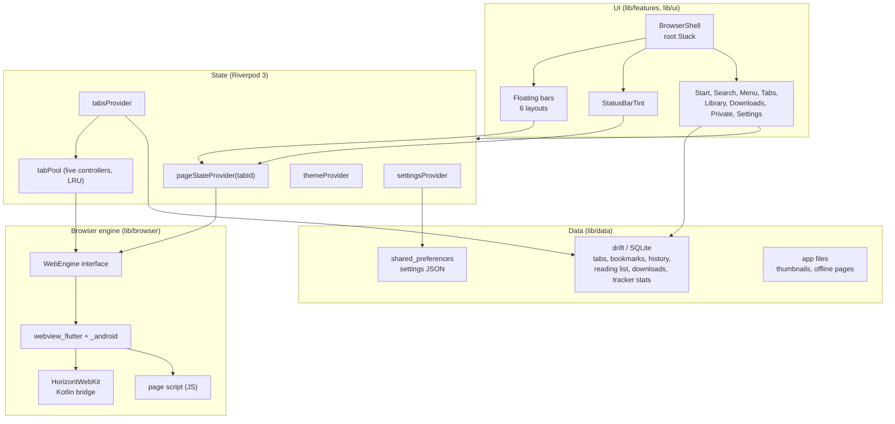

# Horizont: Implementation Plan

> Written 2026-10-23, decisions of section 12 worked in the same day. This is the plan the app was built from; the milestones below are built (see the README for what was checked on a device). Paths such as `~/git/pulse` point to the author's other projects.
> Target: **Android 12+** (API 31), **Pixel 10 Pro**, portrait (fullscreen video may rotate), Flutter **3.47.6** / Dart **3.13.5** (the SDK on this machine).
> Source of truth for layout, spacing, radii, type and navigation: **`referenz/horizont_prototyp.dc.html`** (cited below as `P:<line>`). Design tokens: **`referenz/tokens.json`**. Design rules: **Toms Expressive Design** (`~/git/ledge/toms-expressive-design/README.md`).

Section 12 records Thomas' answers to the open questions (**D1**–**D22**). Where the plan follows one, it cites it.

---

## 0. What Was Read, and What Is Missing

| Input | State |
| :--- | :--- |
| **`referenz/horizont_prototyp.dc.html`** | Read in full (1033 lines: 12 screens, 6 bar layouts, the status bar, the logic in `renderVals`, `scheme`, `shape`, `sw`, `radius`). |
| **`referenz/horizont_prototyp.bundle.html`** | The same prototype as a self-contained bundle (902 KB). Kept for rendering screenshots; not read line by line. |
| **`referenz/tokens.json`** | Read in full. |
| **`referenz/screens/*.png`** | **Do not exist.** Milestone 1 renders them from the bundle (one per screen, light and dark, 412x915). |
| **Pulse** (`~/git/pulse`) | Already implements this design system in Flutter: `lib/theme/app_type.dart` (variable font roles), `color_style.dart` (vibrant seeds, the same five seeds as `tokens.json`), `system_palette.dart` (Material You), springs via `motor`. Horizont ports these files instead of rewriting them. |
| **pill browser** (`~/git/pill browser`) | Earlier attempt with `flutter_inappwebview`, Lucide icons and its own colours. Nothing is taken over except the lesson that the root must be a `Stack` with the web view at the bottom. |

---

## 1. Architecture

### 1.1 Layers

### 1.2 Folders under `lib/`

A table instead of a tree, so it stays readable as files are added.

| **Folder** | **Contents** |
| :--- | :--- |
| **`lib/main.dart`** | Bootstrap: binding, edge-to-edge, load settings and the system palette before the first frame, `ProviderScope`, `runApp`. |
| **`lib/app/`** | `horizont_app.dart` (the `MaterialApp`, theme switching), `browser_shell.dart` (the root `Stack`), `system_ui.dart` (one place that sets `SystemUiOverlayStyle`), `routes.dart` (route builders and the sheet route), `back_handling.dart`. |
| **`lib/theme/`** | `tokens.g.dart` (generated from `tokens.json`), `color_schemes.dart`, `horizont_theme.dart` (`ThemeData` light/dark), `extensions.dart` (colours, radii, spacing, shadows, sizes), `type.dart` (text roles with font axes), `motion.dart` (springs), `system_palette.dart` (ported from Pulse). |
| **`lib/ui/`** | Shared widgets (section 3). Nothing here knows about tabs or web views. |
| **`lib/browser/`** | `web_engine.dart` (interface), `webview_engine.dart` (webview_flutter implementation), `fake_web_engine.dart` (tests), `tab_pool.dart`, `address.dart` (input to URL or search), `search_engines.dart`, `page_script.dart` + `assets/js/horizont_page.js`, `status_bar/` (sampler, tint state, overlay widget), `bars/` (one file per layout plus `bar_actions.dart`), `find_in_page.dart`, `reader.dart`. |
| **`lib/features/`** | One folder per screen: `start/`, `search/`, `menu/`, `tabs/`, `library/`, `downloads/`, `private/`, `settings/` (with `appearance`, `engine`, `privacy`). Each holds the screen and its small private widgets. |
| **`lib/data/`** | `models/` (immutable classes, section 1.5), `db/` (drift database, tables, DAOs), `repositories/`, `settings_store.dart`. |
| **`lib/platform/`** | Dart side of the Kotlin bridge (`horizont_webkit.dart`), `downloads_service.dart`, `biometric_lock.dart`, `intents.dart` (share, open file, pin shortcut, external schemes). |
| **`lib/l10n/`** | ARB files for English and German (`gen-l10n`); the system language decides, English is the fallback (D15). |

Outside `lib/`: **`android/app/src/main/kotlin/.../`** (`MainActivity.kt` as `FlutterFragmentActivity`, `HorizontWebKitPlugin.kt`), **`assets/fonts/`** (Google Sans Flex TTF + OFL), **`assets/js/`**, **`assets/blocklist/`**, **`test/`**, **`integration_test/`**, **`tool/gen_tokens.dart`**.

### 1.3 State Management: Riverpod 3, without code generation

**Recommendation:** `flutter_riverpod` 3.4.3 with hand-written `Notifier`s, no `riverpod_generator`.

- **Why Riverpod:** the browser has many small states that depend on each other (settings → theme → bars; active tab → page state → status bar tint → system icon colour). Riverpod gives that graph, `family` for per-tab state, `ref.onDispose` to dispose a `WebViewController` exactly when its tab leaves the pool, and provider overrides that swap the real engine and database for fakes in tests.
- **Why no generator:** drift already needs `build_runner`, but providers stay readable without it, and a failed generation step then cannot hide a state bug.
- **Alternative considered:** `ChangeNotifier` + `InheritedNotifier` as in Pulse (no dependency). It works for settings, but per-tab families, derived state and test overrides would be hand-built. Not chosen.

Main providers:

| **Provider** | **Type** | **Holds** |
| :--- | :--- | :--- |
| `settingsProvider` | `NotifierProvider<SettingsNotifier, Settings>` | All settings; writes through to `shared_preferences`. |
| `systemPaletteProvider` | `FutureProvider<SystemPalette?>` | Material You schemes, null without them. |
| `themeProvider` | `Provider<(ThemeData light, ThemeData dark)>` | Built from colourway + palette, cached per key (as Pulse does). |
| `tabsProvider` | `NotifierProvider<TabsNotifier, TabsState>` | Ordered normal and private tabs, the active id, the mode (normal/private). |
| `tabPoolProvider` | `Provider<TabPool>` | Live engines per tab id, LRU policy (section 4.1). |
| `pageStateProvider(tabId)` | `NotifierProvider.family` | URL, title, progress, canGoBack/Forward, secure, scroll offset, scrolled flag, page colour, reader on, text zoom. Fed by engine callbacks. |
| `statusBarProvider` | `Provider<StatusBarLook>` | Colour, edge on/off, icon brightness; derived (section 5). |
| `barShrinkProvider` | `NotifierProvider<…, bool>` | Bar shrunk while scrolling down. |
| `downloadsProvider`, `historyProvider`, `bookmarksProvider`, `readingListProvider`, `trackerStatsProvider` | `StreamProvider`s over drift queries | Lists for the screens. |

### 1.4 Navigation and Overlays

The **`BrowserShell`** is mounted once and never rebuilt away: it holds the web views. Everything else is above it.

| **Screen** (prototype) | **How it is shown** | **Why** |
| :--- | :--- | :--- |
| Webseite, Startseite, Privat (`P:21`, `P:60`, `P:131`) | Inside the shell. A tab without a URL shows the start page (normal) or the private page (private) instead of a web view. | They are the content of a tab, with the bars on top (`show.bar`, `P:802`). |
| Suche (`P:313`) | Full-screen `PageRoute` with a fade, opaque. | Covers everything in the prototype; returns to where it came from (`searchFrom`, `P:1019`). |
| Menü (`P:262`) | Own `PopupRoute`: scrim `rgba(0,0,0,0.36)` over the whole screen including the status bar (`P:263`, `sb.dim` `P:972`), sheet inset 8 px, radius 32, drag to dismiss. | `showModalBottomSheet` cannot inset the sheet 8 px on all three sides without fighting its own layout. |
| Tabs, Mediathek, Downloads, Einstellungen, Design & Farbe, Suchmaschine, Datenschutz | `MaterialPageRoute`s. | Predictive back on Android 16 comes with them (Pulse decision 2026-10-07). The "came from" values of the prototype (`settingsFrom`, `privacyFrom`, `P:1022`–`P:1026`) are simply the route stack. |

**Back** on the web page: web view back if possible; else, if the tab was opened by another tab, close it and return to the opener; else show the start page of that tab; else leave the app. `PopScope(canPop: false)` on the shell decides this.

### 1.5 Data Model

All models are immutable Dart classes with `copyWith` written by hand (no `freezed`), `==`/`hashCode` where they are compared.

| **Model** | **Fields** | **Stored** |
| :--- | :--- | :--- |
| **`BrowserTab`** | `id` (uuid v4 from `dart:math` Random.secure, no package), `url?` (null = start page), `title`, `host`, `pageColor?` (ARGB int), `isPrivate`, `openerId?`, `groupId?`, `position`, `createdAt`, `lastActiveAt`, `scrollY?`, `thumbnailPath?` | drift `tabs` (normal tabs only). |
| **`BookmarkFolder`** | `id`, `name`, `icon` (enum), `tone` (enum: primary/secondary/tertiary/neutral, `P:889`–`P:894`), `position`, `isFavorites` | drift `bookmark_folders`. |
| **`Bookmark`** | `id`, `folderId` (FK, cascade), `url`, `title`, `position`, `createdAt` | drift `bookmarks`. |
| **`HistoryVisit`** | `id`, `url`, `title`, `visitedAt` | drift `visits`. |
| **`HistoryPage`** | `url` (unique), `title`, `visitCount`, `lastVisitAt` | drift `pages`; gives "Häufig besucht" and the top hit by frecency. |
| **`ReadingItem`** | `id`, `url`, `title`, `host`, `addedAt`, `readFraction` (0–1), `estimatedMinutes`, `offlinePath?` | drift `reading_items`. State text ("Ungelesen", "Zur Hälfte gelesen", "Offline verfügbar", `P:895`–`P:899`) is derived, not stored. |
| **`DownloadItem`** | `taskId`, `url`, `fileName`, `mimeType`, `host`, `totalBytes?`, `receivedBytes`, `status` (enum), `startedAt`, `finishedAt?`, `savedUri?` | drift `downloads`, mirrored from the downloader's own database. |
| **`TrackerDay`** | `day`, `host`, `blockedCount` | drift `tracker_days`; gives the 7-day number and the comparison with the 7 days before. |
| **`SitePermission`** | `origin`, `kind` (camera/mic/location), `decision` | drift `site_permissions`. |
| **`Settings`** | see table below | `shared_preferences`, one versioned JSON object. |

**Settings** and their defaults, taken from the prototype (`P:1008`–`P:1015`, `P:952`):

| **Key** | **Values** | **Default** |
| :--- | :--- | :--- |
| `themeMode` | light, dark, system | system |
| `colorway` | wallpaper, blue, violet, green, orange, pink | wallpaper where the system has a palette, else blue (D3) |
| `barLayout` | kompakt, zweireihig, expressiv, oben, karte, minimal | kompakt |
| `tintStatusBar` | bool | true |
| `shrinkOnScroll` | bool | true |
| `hideBarAtPageEnd` | bool | false (D4) |
| `searchEngine` | google, ecosia, ddg, startpage, bing | google |
| `searchSuggestions` | bool | true |
| `groupTabs` | bool | true |
| `autoCloseTabs` | never, day, week, month | month |
| `privacy.blockCrossSiteTracking`, `privacy.httpsOnly`, `privacy.fraudWarning`, `privacy.lockPrivateTabs` | bool | true |
| `askBeforeDownload` | bool | true (`P:561`) |
| `textZoomBySite` | map host → percent (50–200, step 10, `P:997`) | empty |
| `startSections` | favorites, frequent, readingList, privacyReport | all on |

SQLite runs with `PRAGMA foreign_keys = ON` and explicit cascades (code guidelines, section 3).

### 1.6 Storage and the Private Mode

- **Nothing private is written:** private tabs, their history, downloads list entries and tracker counts stay in memory and vanish with the last private tab (`P:139`). Downloads saved in private mode stay as files after a warning that they outlive the session; the list entry is not kept (D17).
- **Nothing leaves the device** except what a browser has to send: page requests, search suggestions (only while that switch is on, its subtitle says so, `P:656`) and Safe Browsing checks.

---

## 2. Theme System

### 2.1 From `tokens.json` to Dart

- **`tool/gen_tokens.dart`** (pure Dart, run by hand) reads `referenz/tokens.json` and writes **`lib/theme/tokens.g.dart`**: every colour role light/dark, the seeds, spacing, radii, sizes, shadows and the type roles as `const` values. The file is checked in. A unit test parses the JSON again and fails if the generated file is out of date.
- `status-bad` / `on-status-bad` are references (`{error}`); the generator resolves them.

### 2.2 `ColorScheme`

- **Blue** is built from the tokens, exactly (they agree with the prototype's blue): `ColorScheme.fromSeed(seedColor: seed-blue, dynamicSchemeVariant: vibrant)` for the roles the tokens do not name (`surfaceDim`, `surfaceTint`, `scrim`, `shadow`, fixed roles), then `.copyWith(...)` with all 30 token colour roles. Mapping: `primary-container` → `primaryContainer`, `surface-container-highest` → `surfaceContainerHighest`, `surface-bright` → `surfaceBright`, `inverse-surface` → `inverseSurface`, `inverse-on-surface` → `onInverseSurface`, and so on one to one.
- **Violet, green, orange, pink** come from the prototype's tables (next point), with missing roles from `ColorScheme.fromSeed(seed, vibrant)`.
- **Fidelity test:** the prototype carries all five colourways as hex strings (`P:724`–`P:745`, 23 roles each, light and dark). **These values are the colourways** (D2): `tool/gen_tokens.dart` also extracts them into fixed tables, and `fromSeed(vibrant)` only fills the roles the prototype does not list. A unit test checks the tables against the prototype.
- **Material You:** `dynamic_color`'s `DynamicColorPlugin.getCorePalette()` through Pulse's `loadSystemPalette()`; null on failure, then blue is used. **Material You is the default** wherever the system has a palette (D3); in Design & Farbe it is the first swatch, "Hintergrund", before the five fixed colourways, and hidden where no palette exists. Status colours, illustration colours and the private surfaces stay fixed in every colourway.
- **Private mode** always uses the dark scheme of the current colourway (`dark = theme === 'dark' || screen === 'private'`, `P:792`) plus the private surfaces of 2.3.

### 2.3 Theme Extensions

All implement `lerp`, so a theme change animates.

| **Extension** | **Fields** | **Source** |
| :--- | :--- | :--- |
| **`HorizontColors`** | `statusGood`/`onStatusGood`, `statusWarn`/`onStatusWarn`, `statusBad`/`onStatusBad`, `illustrationSun`, `illustrationNight`, `glass` (= `surfaceContainerHighest`, opaque; at alpha `0xB3` with "Durchscheinend", D31), `scrim` (black 36 %), `privateSurface` `#1B2650`, `privateOnSurfaceVariant` `#C9D1EE` (`P:142`, `P:139`) | tokens, prototype |
| **`HorizontRadii`** | small 8, medium 12, large 16, largeIncreased 20, tile 24, extraLarge 28, extraLargeIncreased 32, extraExtraLarge 48, full; plus `groupItem(index, count)` returning the `BorderRadius` of `radius()` (`P:777`) | tokens, prototype |
| **`HorizontSpacing`** | space1 … space8 (4 … 32) | tokens |
| **`HorizontShadows`** | `floating` (two `BoxShadow`s: 0/3/8 at 16 %, 0/1/3 at 12 %), `button` (0/2/6 at 18 %) | tokens |
| **`HorizontSizes`** | bar 64, touch 48, fab 56, heroBadge 116, metricCircle 108, badge 40 | tokens |

Literal colours exist only in `lib/theme/` (code guidelines). The demo website colours (`w`, `P:810`–`P:812`) are not theme; they belong to the local test page (milestone 2).

### 2.4 Type

Ported from Pulse's `AppType` and extended with the roles below. Each role is a `TextStyle` with `fontFamily: 'Google Sans Flex'`, `fontSize`, `height` (line height / size), `fontWeight` and **`fontVariations`**: `wght`, `wdth`, `ROND`, `opsz`, and `slnt` where needed.

| **Role** | **Size/line** | **wght** | **wdth** | **Other** | **Used at** |
| :--- | :--- | :--- | :--- | :--- | :--- |
| `display` | 36/44 | 450 | 100 | | screen titles (`P:355`, `P:391`, `P:454`, `P:499`) |
| `brand` | 36/44 | 800 | 108 | | "Horizont" (`P:65`) |
| `badgeNumber` | 32/36 | 800 | 112 | tabular figures | hero numbers (`P:73`, `P:675`) |
| `metricL` | 34/40 | 800 | 112 | tabular | download tiles (`P:459`) |
| `headline` | 24/32 | 750 | 108 | | section headers (`P:83`) |
| `title` | 17/24 | 750 | 108 | | card titles (`P:77`) |
| `subtitle` | 16/24 | 450 | 100 | | under titles (`P:64`) |
| `body` | 14/20 | 400 | 100 | 500 for list titles | |
| `bodyStrong` | 14/20 | 700 | 100 | | comparison sentence (`P:78`) |
| `label` | 12/16 | 450 | 88 | | what a number is (`P:76`) |
| `aside` | 12/16 | 400 | 100 | `slnt -10` | "Gezählt auf diesem Gerät." (`P:79`) |
| `navLabel` | 15/20 | 500 → 800 | 96 → 112 | animated | selected pill (`P:220`, `P:381`) |
| `address` | 15/20 | 600 | 100 | | address pill (`P:166`) |
| `addressSmall` | 13/18 | 600 | 96 | | minimal bar (`P:253`) |
| `tileLabel` | 12/16 | 600 | 92 | | menu tiles (`P:275`) |
| `monogram` | 16 or 22 | 800 | 100 or 110 | | letter badges (`P:89`, `P:100`) |

Three pitfalls this design answers:

- **Variations do not merge.** `TextStyle.merge` replaces the whole `fontVariations` list, so a role that sets `wght` loses the `ROND 100` of the screen root. Every role therefore carries all axes itself (Pulse's `_vary` does this).
- **Optical size is not automatic.** Browsers set `opsz` to the font size (`font-optical-sizing: auto`); Flutter does not. Each role sets `opsz` = font size, otherwise the type looks wider and looser than in the prototype.
- **Weight and `wght` together.** `fontWeight` is set as well as `wght`, so semantics and fallback fonts get the right weight.

The font is the TTF from Pulse (`~/git/pulse/assets/fonts/GoogleSansFlex.ttf`, axes checked: `opsz` 6–144, `wdth` 25–151, `wght` 1–1000, `GRAD`, `ROND` 0–100, `slnt` −10–0). Flutter cannot load the `woff2` of the design system.

### 2.5 Icons

**Material Symbols Rounded**, outlined; filled (`FILL 1`) only for the selected navigation item and the status-bar glyphs of the prototype. Package `material_symbols_icons` (section 9); Flutter's `Icon` has `fill`, `weight`, `grade`, `opticalSize`. All 64 icon names used in the prototype (51 in the markup, 13 more in the script data) are listed in milestone 1 and checked against the package. Risk R9: icon tree shaking must keep the variable axes in a release build.

### 2.6 Switching

`HorizontApp` watches `settingsProvider` and `systemPaletteProvider`, builds `theme`/`darkTheme` from the cache, and passes `themeMode`. A change animates through `ThemeData.lerp` (the extensions lerp too). The Kotlin bridge is told the effective brightness so web pages get the matching `prefers-color-scheme` (R6).

---

## 3. Widget Inventory

All in `lib/ui/` unless noted. Each takes colours from the theme, never as parameters with hex values.

| **Widget** | **What it is** | **Prototype** |
| :--- | :--- | :--- |
| **`FloatingSurface`** | The glass of every floating bar: `HorizontColors.glass`, optional blur 24, `shadow-floating`, a shape. Blur is a constructor flag so it can be switched off per device (R2). | `P:161`, `P:162`, `P:181` |
| **`RoundButton`** | Circle 44, 48 or 56, icon 20–28, variants: glass (floating, with shadow), filled `surfaceContainerHighest`, plain, tonal `primary`. | `P:161`, `P:170`, `P:272`, `P:452` |
| **`PillButton`** | Pill with icon and/or label, heights 44/48/52/56, variants glass/highest/primary/errorContainer/error. | `P:151`, `P:347`, `P:383`, `P:392`, `P:418`, `P:694` |
| **`AddressPill`** | Lock or search icon + domain, ellipsis, centred or left, in four sizes (kompakt 48 inside a 56 bar, zweireihig 52, oben 56 with mic well, expressiv/minimal 44). Optional reload button and reader toggle slots. | `P:164`, `P:177`, `P:194`, `P:213`, `P:251` |
| **`TabCountGlyph`** | Rounded 24x24 square, 2 px border, count in 12/800. | `P:186` |
| **`ExpressiveShapePainter`** + **`shapePath(n, amp, size)`** | The prototype's polar shape `r = r0·(1 + amp·cos(nθ))` as a pure function returning a `Path`, painted by a `CustomPainter`. Presets: hero9 (9, 0.07), hero6 (6, 0.08), sunny (12, 0.06), flower (8, 0.12), favourites 4/6/8/5. Later morphs between presets (milestone 10). | `P:758`–`P:767`, `P:1002`–`P:1007`, `P:855` |
| **`ShapeBadge`** | Shape with a number, icon or letter centred on it (116, 72, 64). | `P:71`–`P:74`, `P:134`, `P:502`, `P:673`, `P:87` |
| **`HeroCard`** | Container-tone card, radius 32, padding 20: shape badge + label, title, bodyStrong, aside. Used for the privacy report (start, privacy page) and the Design & Farbe entry. | `P:70`–`P:81`, `P:501`–`P:512`, `P:672`–`P:683` |
| **`ListGroup`** + **`ListRow`** | Rows 4 px apart, outer corners 24, inner 8 (`groupItem`). Row: leading `IconWell` or `Monogram`, title (body 500) + subtitle (12/16 on-surface-variant), trailing chevron, switch, time, arrow, button, radio or stepper. Min heights 56/60/64/72. | `P:97`–`P:107`, `P:281`–`P:299`, `P:515`–`P:536`, `P:687` |
| **`IconWell`** | 40x40, radius 12, a tone pair; icon 20. | `P:100`, `P:143`, `P:517` |
| **`Monogram`** | Letter on a well (40/12 or 24/8) or on a shape (64). Stands in for favicons (D12). | `P:100`, `P:369`, `P:89` |
| **`HorizontSwitch`** | 52x32 track, knob 24 on / 16 off, `primary` / `surfaceContainerHighest` with `outline` border. Flutter's M3 `Switch` has these measures; it is themed, not rebuilt, unless the knob animation differs on device. | `P:768`–`P:776`, `P:285` |
| **`SegmentRow`** | Connected buttons 2 px apart: ends pill-rounded on the outside and 8 inside; the selected one becomes a full pill in `primary`, label 800/wdth 108, others 500/96. Heights 48 (library) and 56 (mode). | `P:394`–`P:398`, `P:588`–`P:592`, `P:874`–`P:882`, `P:901`–`P:909` |
| **`ActionTile`** | 84 high, radius 24, icon over a 12/600 label; first one in `primaryContainer` (one loud thing). | `P:274`–`P:279` |
| **`GridGroup`** | The 2-column group with per-corner radii (24 on the outer corners only). | `P:301`–`P:308` |
| **`Stepper`** | Minus, value "100 %" (15/800/wdth 106, tabular), plus, on a `surfaceContainerHigh` pill. | `P:290`–`P:294` |
| **`QuickChip`** | 36 high, radius 12, icon 18 + label 600; selected in `secondaryContainer`. | `P:333`–`P:338` |
| **`FolderTile`** | 124 high, radius 28, icon well top-left, title + count bottom-left. | `P:424`–`P:427` |
| **`StatTile`** | Number tile (metricL), label, then bodyStrong or aside. | `P:458`–`P:467` |
| **`ReadingCard`** (carousel) / **`ReadingRow`** | 240 wide card with a 96 colour band; row with 88 square, title, host, state in `primary`. | `P:112`–`P:125`, `P:435`–`P:442` |
| **`TabCard`** | Preview (200 high, radius 24/24/8/8) above a title strip (radius 8/8/24/24) with monogram, title and close; the active one has a 3 px `primary` ring 2 px off. | `P:360`–`P:373` |
| **`LinearProgress`** | 6 high, radius 3, `primary` on `primaryContainer`. | `P:475` |
| **`ColorwaySwatch`** | 52 circle split into primary (top half), tertiary container (bottom right), primary container; check mark and ring when selected. | `P:597`–`P:604` |
| **`LayoutPreview`** | 72x112 mini screen with up to three boxes per layout (coordinates in `lyDefs`). | `P:611`–`P:618`, `P:924`–`P:931` |
| **`EngineRow`** | Radio row; selected row in `primaryContainer` with a `primary` badge. | `P:646`–`P:650`, `P:823`–`P:833` |
| **`SheetSurface`** + **`DragHandle`** | Radius 32 sheet in `surfaceContainer`, 36x4 handle in `outline`. | `P:264`, `P:265` |
| **`ScreenHeader`** | Back `RoundButton` (48, `surfaceContainerHighest`), then `display` title and optional subtitle, top padding status bar height + 12 (52 in the prototype). | `P:452`–`P:456`, `P:498`–`P:499` |
| **`SectionHeader`** | `headline`, margin 28 above, 12 below, 4 inset. | `P:83` |
| **`Squish`** | Shared press feedback: scale to about 0.92 on a spatial spring with a small overshoot back, no ripple, haptic tick. Every tappable widget above uses it (6.1). | — |

**Bars** (in `lib/browser/bars/`), each a widget over `BarActions` (back, forward, reload, reader, search, menu, tabs, library, newTab, start):

| **Layout** | **Composition** | **Prototype** |
| :--- | :--- | :--- |
| **`CompactBar`** (kompakt) | Glass back button 56 · glass pill 56 (reader 48, address, reload 48) · glass menu button 56; bottom 28, sides 16, gap 8. | `P:159`–`P:172` |
| **`TwoRowBar`** (zweireihig) | Address pill 52, gap 8, toolbar 64/radius 32 with back, forward, share, library, tabs; bottom 24. | `P:175`–`P:189` |
| **`ExpressiveBar`** (expressiv) | Address chip 44 at the top (centred, max 280), toolbar 64 with back, forward, tabs, menu + search FAB 64/radius 20 in `tertiaryContainer`. | `P:192`–`P:208` |
| **`TopBar`** (oben) | Address field 56 at the top with mic well; nav bar 64 at the bottom with a filled `primary` pill ("Seite"/"Start") and three icons. | `P:211`–`P:225` |
| **`CardBar`** (karte) | Grouped card: address row 56 (radius 24/24/8/8, two lines) + toolbar 56 (radius 8/8/24/24) with a `primary` new-tab pill 64x44; one drop shadow for both. | `P:228`–`P:246` |
| **`MinimalBar`** (minimal) | Address pill 44 (200–260 wide) + menu button 44, bottom 20. Also the shrunk form of every layout while scrolling. | `P:249`–`P:257` |

Content top padding per layout: oben 120, expressiv 104, otherwise 52 (`P:808`); the search field sits at the top for oben, else at the bottom (`P:868`–`P:870`).

---

## 4. Browser Core

### 4.1 Tabs and Web View Controllers

- **One engine per live tab.** In `webview_flutter` 4 the `WebViewController` owns the native `WebView`; a `WebViewWidget` only shows it. So a tab can keep its page alive without being on screen, and only the active tab's widget is in the tree.
- **Pool:** at most **3** live engines (active + 2 most recent) (D21). A tab leaving the pool saves `url`, `title`, `scrollY` and a thumbnail, then its controller is disposed. Activating a cold tab creates an engine, loads the URL and restores the scroll offset after `onPageFinished`.
- **Memory pressure:** `onTrimMemory` from the bridge (or `didHaveMemoryPressure`) shrinks the pool to the active tab.
- **Restore on start:** tabs come from drift; only the active one loads. The back/forward list of a tab is lost on restore, because the plugin does not expose `WebView.saveState`.
- **Thumbnails:** captured natively (`WebView.draw` into a scaled bitmap, via the bridge) when a tab is left and when the tab overview opens, stored as WebP in the app's files. Fallback when capture fails: the prototype's abstract card (colour band in the page colour, three grey lines, `P:361`–`P:367`).
- **Grouping** ("Gruppe „Schafberg“", `P:356`): tabs opened from another tab join the opener's group, named after the opener's title (D13).
- **Auto-close:** at start, tabs whose `lastActiveAt` is older than the setting are closed.

### 4.2 Address and Search Input

`address.dart`, pure and unit-tested:

- Has a scheme (`https:`, `http:`, `about:`, `file:` refused) → URL as is.
- Looks like a host (`a.b`, `localhost`, IPv4/IPv6, optional port and path, no spaces) → `https://` + input.
- Anything else → search URL of the chosen engine.
- `http://` with HTTPS-only on → upgraded; if the upgrade fails, an interstitial page (Flutter) offers to continue.
- `intent:`, `mailto:`, `tel:`, `geo:` and other schemes from pages are handed to Android through the bridge after a confirmation.

**Suggestions** (`P:861`–`P:867`): local first (history, bookmarks, reading list by frecency; the best one is the **top hit**, `P:316`), then engine suggestions over `dart:io` `HttpClient`, debounced 150 ms, cancelled on the next keystroke, off in private mode. There is no preloading of the top hit (D14). Endpoints per engine are in `search_engines.dart` and tested with recorded responses. **Quick search chips** (Bilder, Karten, News, Wetter) map to the engine's vertical URLs.

### 4.3 Downloads

- **Detection:** the plugin's own download listener only forwards the URL as a navigation request (seen in `webview_flutter_android` 4.14.1, `android_webview_controller.dart:1580`), without MIME type, size or `Content-Disposition`. The bridge therefore sets its own `DownloadListener` on the native `WebView` after the plugin has set its delegate, and sends all five values to Dart.
- **Transfer:** `background_downloader` (pause/resume as in `P:478`, a system notification, saving into the shared **Download** folder through MediaStore as the subtitle says, `P:455`). Cookies come from `CookieManager.getCookie(url)` and the page's user agent, so downloads behind a login work.
- **`blob:` and `data:` URLs:** fetched inside the page by the page script and handed over in chunks as base64, then written by Dart.
- **Ask before saving:** a small sheet with name, size and host when the setting is on.

### 4.4 Private Mode Isolation

- **Separate profile:** `androidx.webkit` (1.15, already a dependency of the plugin) has a multi-profile API. The bridge gets the native `WebView` through `WebViewFlutterAndroidExternalApi.getWebView(binding, identifier)` (since 4.13.0) and calls `WebViewCompat.setProfile(webView, "private")` before the first load. Private tabs then have their own cookies, storage, cache and service workers. Leaving private mode calls `ProfileStore.deleteProfile("private")`.
- **Fallback** where `MULTI_PROFILE` is missing: private mode is refused with a message, not faked by clearing shared cookies.
- **No traces:** no history, no thumbnails on disk (memory only), no tracker statistics, no suggestions. No `FLAG_SECURE`: screenshots of private tabs stay possible (D20).
- **Lock:** with "Private Tabs sperren" on, leaving the app covers private content; coming back asks for the fingerprint (`local_auth`; `MainActivity` becomes a `FlutterFragmentActivity`).

### 4.5 The Kotlin Bridge (`HorizontWebKitPlugin`)

The plugin covers loading, navigation, JS, cookies, scroll position, text zoom, user agent, permissions, file chooser, fullscreen video (`setCustomWidgetCallbacks`) and passkey support (`setWebAuthenticationSupport`). These are not in it and go through one small app-side plugin keyed by the controller's `webViewIdentifier`:

| **Call** | **Android API** | **For** |
| :--- | :--- | :--- |
| `setProfile`, `deleteProfile` | `WebViewCompat.setProfile`, `ProfileStore` | private mode |
| `setDownloadListener` | `WebView.setDownloadListener` | downloads |
| `addDocumentStartScript` | `WebViewCompat.addDocumentStartJavaScript` | page script before page code runs |
| `find`, `findNext`, `clearMatches` | `WebView.findAllAsync`, `FindListener` | Suchen auf der Seite (`P:278`) |
| `capture` | `WebView.draw` into a bitmap | thumbnails, colour sampling fallback |
| `setRequestBlocker` | wrapping `WebViewClient.shouldInterceptRequest` | tracker blocking (R4) |
| `setSafeBrowsing` | `WebSettingsCompat.setSafeBrowsingEnabled` | Betrugswarnung |
| `setAlgorithmicDarkening`, `setNightMode` | `WebSettingsCompat`, `UiModeManager.setApplicationNightMode` | page dark mode (R6) |
| `saveWebArchive` | `WebView.saveWebArchive` | reading list offline |
| `pinShortcut`, `share`, `openFile`, `openExternal` | `ShortcutManagerCompat`, intents | menu actions, downloads |

The page can reach Dart only through one `JavaScriptChannel` named `Horizont`. Every message is size-limited, parsed as JSON and checked for its exact shape; anything else is dropped. No message can trigger navigation, file access or a setting.

---

## 5. The Status Bar in Detail

### 5.1 What the prototype says (`P:957`–`P:974`, `P:699`–`P:711`)

| **Situation** | **Colour** | **Edge** | **Height** |
| :--- | :--- | :--- | :--- |
| Web page, tint on, at top | page header colour, solid | no | status bar only |
| Web page, tint on, scrolled (> 6 px) | page colour at 85 % + blur 16, fading out from 40 to 56 | yes | status bar + 16 |
| Web page, tint off | `surfaceContainer` | as above | as above |
| Start page and app screens | `surfaceContainer` | always | status bar + 16 |
| Private page | `#101A38` (illustration-night) | always | status bar + 16 |
| Menu open | the sheet's scrim covers it | — | — |

Icon colour: dark when the prototype's luminance `(0.2126 R + 0.7152 G + 0.0722 B) / 255 > 0.55`, else light (`P:961`, `P:966`). That formula uses gamma-encoded values; it is kept as is (a pure function with tests) so the result matches the prototype rather than WCAG luminance.

### 5.2 Edge-to-edge setup

- `SystemChrome.setEnabledSystemUIMode(SystemUiMode.edgeToEdge)` at start; Android 15+ enforces edge-to-edge anyway with targetSdk 35+.
- `android:windowLayoutInDisplayCutoutMode="shortEdges"` for the punch hole.
- Status and navigation bar colours are transparent and ignored on Android 15+, so **the app paints the tint itself**. `systemNavigationBarContrastEnforced: false`, so Android draws no scrim behind the gesture bar.
- **One `AnnotatedRegion<SystemUiOverlayStyle>`** in the shell, driven by `statusBarProvider`; no `AppBar` anywhere (it would set its own). Routes above the shell wrap themselves in one too, with the screen's `surfaceContainer` brightness.

### 5.3 Insets and layout

- **Web view top** = `MediaQuery.viewPadding.top` (layouts kompakt, zweireihig, karte, minimal). For **oben** and **expressiv** the web view starts below the top element (status bar + 8 + 56 + 8, or + 44 + 8), and the tint covers that strip too.
- **Web view bottom** = screen bottom; the bars float over the page (page end: 5.5).
- **Do not let the web view inset itself:** `setInsetsForWebContentToIgnore([systemBars, displayCutout])` (plugin 4.11.0+), because Flutter already places the view below the status bar; otherwise Android 15+ pads the page a second time through `env(safe-area-inset-*)`. Whether `ime` must be ignored too is checked on the device (keyboard over a form field).

### 5.4 Finding the page colour

The page script (`assets/js/horizont_page.js`) is added at document start through the bridge (fallback: `runJavaScript` on `onPageStarted` and `onPageFinished`). It:

1. Reads `<meta name="theme-color">`, honouring a `media` attribute that matches the current `prefers-color-scheme`.
2. Without one, looks at the elements at the top edge: `elementsFromPoint(x, 1)` at 8 px, the middle and width − 8 px; walks up each until a computed `background-color` with alpha > 0; takes the colour two of three agree on, else the middle one; then `body` and `html`; else white.
3. If the winning element has a `background-image` (gradient, photo), reports "unknown"; Dart then samples the top 4 rows of a small native capture (bridge `capture`).
4. Watches the meta tag with a `MutationObserver` and `prefers-color-scheme` changes.
5. Reports `{type:"color", rgba, source:"meta"|"dom"|"unknown"}` through the channel.

**When and how often:**

| **Trigger** | **Throttle** |
| :--- | :--- |
| `onPageStarted` | keep the old colour until the new page reports (no flash to white) |
| first report after DOM ready, then `onPageFinished` | immediately |
| meta tag changed | debounced 100 ms |
| `onUrlChange` (single-page apps) | 300 ms after the change |
| scroll comes to rest, only if the source is not `meta` | 250 ms after the last scroll event, at most every 500 ms |
| sampling fallback | at most once per second, only for `unknown` |

Colours are compared in Dart; a change below a small distance is ignored so the bar does not flicker.

### 5.5 Transition while scrolling

- **Scroll source:** `setOnScrollPositionChange` (native view scroll). Pages that scroll an inner element (body `overflow: hidden`) report nothing there, so the page script also listens to `scroll` in the capture phase and reports throttled to one frame.
- **Scrolled flag** at > 6 px (`P:983`). It drives an effect spring (no overshoot) on the edge's opacity and the extra 16 px, so the solid band becomes the soft edge without a jump. Colour changes run through the same kind of spring.
- **The edge:** a `ShaderMask` with the linear gradient (opaque to 40, transparent at 56, scaled to the real status bar height) over a box in the page colour at alpha `0xD9`. The `BackdropFilter` (blur 16) is added only if it renders over the web view at full frame rate (R2).
- **Shrink on scroll** (`barShrinkProvider`): down by more than 24 px since the last direction change shrinks the bars to the minimal form; up by 24 px or a tap on the minimal pill expands them (D4).
- **Page end:** the web view always reaches the screen bottom and the bars float over it. With "Am Seitenende ausblenden" on (`hideBarAtPageEnd`, a switch in Design & Farbe › Leiste, below "Beim Scrollen verkleinern"), the bars fade out completely when the page end is reached (`scrollY + viewport >= contentHeight − 2`, reported by the page script) and come back on the first scroll up (D4).

### 5.6 Scroll to top

Android delivers no taps on the status bar to apps, as far as known: the system window above it takes them. The plan therefore makes the **soft edge itself** the target: while the page is scrolled, the 16 px edge below the status bar plus 8 px of invisible margin is a button; a tap scrolls smoothly to the top (`window.scrollTo({top: 0, behavior: 'smooth'})`, fallback `scrollTo(0, 0)`), with a light haptic. Milestone 3 first checks on the Pixel whether taps on the status bar itself reach the app; if they do, the target grows to cover it. The switch "Websitefarbe übernehmen" (`P:625`) turns the tint off; the tap target stays.

### 5.7 Known pitfalls with webview_flutter on Android

1. **Composition mode.** The plugin defaults to Texture Layer Hybrid Composition (`displayWithHybridComposition: false`). It lets Flutter draw and blur over the page, but has had issues with keyboard input, accessibility focus and some video. Hybrid Composition fixes those but costs frame time and Flutter's `BackdropFilter` does not see the page. Milestone 2 measures both on the Pixel.
2. **Blur cost.** Pulse found backdrop filters over scrolling content too slow on a Pixel 10 Pro (decision 2026-10-07). The glass is 92 % opaque anyway (`P:750`), so the bars are planned without blur first.
3. **Overlay style ownership:** the last `AnnotatedRegion` painted under the status bar wins; a route without one inherits whatever is below. Every route sets its own.
4. **No document-start script in the plugin.** Without the bridge, the page script runs only after `onPageStarted`, too late for early `theme-color` and scroll listeners.
5. **Reattaching a controller** to a new `WebViewWidget` after the tab overview: give the widget a key per tab and check for a blank view on the device.
6. **`prefers-color-scheme`** in the web view follows the activity's night mode, not Flutter's `themeMode` (R6).
7. **JavaScript channel is visible to every page.** It is treated as untrusted input (4.5).
8. **Scroll events cross a platform channel per frame.** Only threshold crossings change providers; raw offsets stay in a plain field.
9. **Keyboard:** Flutter resizes the shell (`resizeToAvoidBottomInset`); the bars hide while the keyboard is up for the page.
10. **Fullscreen video:** `setCustomWidgetCallbacks` gives a widget; the shell hides bars and tint and switches to immersive mode until it is hidden.

---

## 6. Motion

Horizont should feel playful and fluid, in the manner of Safari on iOS 26: things are picked up, stretched and thrown, and surfaces grow out of the control that opened them. Performance comes first (section 7): an animation that cannot hold the frame budget on the Pixel 10 Pro is simplified until it does (D24). Only motion is meant here; the refracting Liquid Glass material is not part of the plan (7.3).

### 6.1 Principles

- **Springs only, never fixed durations.** All motion runs on `motor` springs with the Material 3 Expressive tokens (`MaterialSpringMotion.expressiveSpatialFast/Default/Slow`, `expressiveEffectsFast/Default/Slow`, wrapped in `lib/theme/motion.dart` as in Pulse). Spatial springs (position, size, scale, shape) may overshoot; effect springs (colour, opacity, numbers) never do.
- **Interruptible and velocity-true.** Every animation can be grabbed in flight; the spring takes over the finger's velocity on release and retargets from where it is, never from the start.
- **Things come from where they are.** The menu grows out of the menu button, the search field out of the address pill, a tab card out of the page and back. Nothing appears from nowhere or slides in from a fixed edge without a reason.
- **Gestures first.** Everything that opens with a tap can also be pulled: the sheet down, a tab card sideways, the bar left and right, the tab overview by a swipe up on the bar.
- **Playful within limits.** A press squeezes (scale to about 0.92 with a small overshoot back); a drag past its end stretches elastically (rubber band) instead of stopping dead. Nothing moves at rest, nothing loops for decoration (design system, Motion).
- **Haptics with meaning.** A light tick when a drag crosses a threshold (tab switches, sheet will close), a firmer one on confirm; never on every frame.
- **Reduced motion.** With Android's "Remove animations" or the battery saver, spatial springs become short effect fades and nothing overshoots.

### 6.2 The choreography, screen by screen

| **Moment** | **What moves** | **How** |
| :--- | :--- | :--- |
| **Bar shrinks while scrolling** | The bar morphs into the minimal pill: width, height and radius interpolate, side buttons scale down and fade into the pill, the domain text narrows (`wdth` 100 → 96, size 15 → 13). | One spatial spring driven by a 0–1 progress; reversible mid-way. |
| **Bar hides at the page end** (D4) | The pill sinks below the edge and fades; returns on the first scroll up. | Spatial spring on translation, effect spring on opacity. |
| **Swipe on the bar switches tabs** | Dragging the address pill left or right drags the page with it; the neighbour tab's thumbnail slides in beside it. Past a third of the width (or a fast fling) it commits. | Follows the finger 1:1, then a spatial spring with the fling velocity; a tick at the commit threshold. |
| **Address pill → search** | The pill lifts and stretches into the search field at the keyboard's edge (or at the top for oben); the bar's other buttons fall away; suggestion rows stagger in 20 ms apart. Cancel reverses the same path. | Shared-element morph (rect + radius) on a spatial spring; rows on effect springs. |
| **Menu sheet** | The sheet grows out of the menu button: starts as the button's circle, opens to the sheet's rect and radius 32; tiles and rows stagger in. Pulling it down shrinks it back toward the button; a fling closes it. | Spatial spring on a rect/radius tween; drag hands over velocity. |
| **Tab overview** | The current page zooms out into its card in the grid while the other cards fly in around it; tapping a card zooms it to full screen. Swipe up on the bar opens the overview with the page following the finger. | Shared-element zoom with the live view swapped for its snapshot during the flight (7.2); grid cards on staggered spatial springs. |
| **Close a tab** | A card is flicked sideways and flies off with its velocity, rotating a little; the others reflow into the gap. | Drag 1:1, spatial springs for the reflow. |
| **New tab** | The new card pops out of the + button, then zooms to the start page. | Spatial spring with overshoot. |
| **Page loads** | The progress line in the address pill runs on an effect spring and turns into a short travelling wave when it reaches 100 % before it fades (design system: a progress that reaches 100 % may turn into a wave). | Effect spring, one wave cycle. |
| **Status bar tint** | Colour cross-fades between pages; the soft edge grows in when scrolling starts. | Effect springs (5.5). |
| **Layout change in Design & Farbe** | The bars of the old layout fly to the places of the new one; elements that exist in both keep their identity. | Keyed spatial springs per element. |
| **Segments and switches** | The selected pill slides to its new segment and its label goes 500 → 800, `wdth` 96 → 112; the switch knob grows from 16 to 24 as it travels. | Spatial spring (pill, knob), effect spring (weight). |
| **Shapes** | The privacy number's shape morphs when the count changes; favourites squish and spin a few degrees on press. | Morph between precomputed point lists. |
| **Numbers** | Counts up lighter and settles at full weight (design system). | Effect spring. |
| **Back** | Predictive back on every Flutter route (Android 16); for the web page, an edge swipe shows the previous page's snapshot sliding in under the current one **[stretch goal, after M11]**. | System predictive back events; snapshot taken when a navigation starts. |

### 6.3 Building blocks

- `lib/theme/motion.dart`: the spring tokens, `Motion.reduced(context)`.
- `lib/ui/motion/`: `Squish` (press feedback, replaces the plain `Pressable`), `RubberBand` (elastic overscroll for drags), `SharedMorph` (rect + radius morph between two keyed widgets across a route, own overlay entry instead of `Hero`, because `Hero` animates only rects on a fixed curve), `StaggeredEntrance`, `SpringValue` helpers over `motor`.
- Shape morphs use point lists precomputed per preset (same number of points), so a morph is a lerp of two lists, not a path rebuild per frame.

---

## 7. Performance

Performance is a top priority (D24). The target is the Pixel 10 Pro at **120 Hz**, so a frame has **8.3 ms**.

### 7.1 Budgets

| **What** | **Budget** (profile build on the Pixel 10 Pro) |
| :--- | :--- |
| **Frames** while scrolling a page, with every animation of 6.2 | 99 % of frames under 8.3 ms (build + raster), no frame over 16.6 ms |
| **UI thread** per frame | under 4 ms |
| **Raster thread** per frame | under 6 ms |
| **Cold start** to the first frame with the bar | under 600 ms; first page painted under 1.2 s on a fast connection |
| **Tap to response** (bar buttons, sheet, overview) | movement starts in the next frame |
| **Typing** in the search field | suggestions from local data within one frame; network ones never block typing |
| **Memory** with 20 tabs | measured in M4, then kept: no growth after closing them |
| **Idle** | no frames scheduled when nothing moves (checked with the performance overlay) |

### 7.2 How the budgets are met

- **Impeller on Vulkan** (Flutter's default on Android); nothing that needs Skia.
- **Animate only transform, opacity and clip.** Animations never change layout; bars and sheets are positioned once and moved with `Transform`/`FractionalTranslation`; text width changes (`wdth`, `wght` on the nav label) happen inside a box of fixed size so neighbours do not relayout.
- **`RepaintBoundary`** around the bars, the status tint, each tab card and the sheet, so a moving bar does not repaint the page layer.
- **The live web view is not animated.** For zooms and slides (overview, tab swipe, back preview) it is swapped for its snapshot during the flight and back at rest. Transforming a platform view every frame costs composition time and is unreliable in Hybrid Composition.
- **No blur by default.** The glass is opaque and has no `BackdropFilter` (D31; with "Durchscheinend" only over the app's own screens, never over the page); the soft status edge uses a gradient mask. Blur is added only where the M2 spike measured it inside the budget (Pulse lost scrolling to backdrop filters on the same phone).
- **No platform-channel traffic per frame in Dart state.** Scroll offsets go into a plain field and a `ValueNotifier` the bar listens to; providers change only at thresholds. Riverpod `select` everywhere so a page title change does not rebuild the bar.
- **Precomputed shapes and cached paths.** `shapePath` results are cached per (preset, size); morph point lists are built once.
- **Images at display size.** Thumbnails stored as small WebP, decoded with `cacheWidth` at card size; grids and lists are lazy builders.
- **Warm the engine early.** The first `WebView` costs Chromium's start-up; it is created while the first frame shows the start page, so the first URL does not pay it.
- **Work off the UI isolate.** Blocklist parsing, history search and suggestion merging run in `Isolate.run`; drift runs on its own isolate (`drift_flutter`).
- **Start-up order:** settings and palette before the first frame, database and tab restore after it, inactive tabs never before they are opened.
- **Throttled native work:** colour sampling and thumbnails per the tables in 4.1 and 5.4, never per frame.

### 7.3 What is deliberately left out

- **Refracting Liquid Glass** (as Pulse has it with `liquid_glass_renderer`): it is a pre-release, Impeller only, and samples what lies beneath; over a scrolling web view that is a full-screen texture read every frame. Not planned. If wanted later, only for the small bar and after measuring.
- **Animating the web content itself** (zooming the live page, parallax).

### 7.4 Measuring

- **Frame log** ported from Pulse (`lib/app/frame_log.dart`, `--dart-define=FRAME_STATS=true`), reporting slow frames with what happened just before them, read with `adb logcat`.
- **Performance integration tests** (`integration_test` + `traceAction`): scroll a long local article, shrink and expand the bar, open and close the sheet, open the overview with 12 tabs, switch tabs by swiping the bar. Each writes a timeline summary; a small `tool/perf_report.dart` checks it against the budgets of 7.1.
- **The emulator shows correctness, not speed.** Screenshots and behaviour come from it (D16); every number in 7.1 comes from the Pixel 10 Pro in a profile build.
- **Gate per milestone:** a milestone that adds motion or a screen is not done until its perf test passes on the phone, or until the miss is written down with the reason and the plan to fix it.

---

## 8. Milestones

Each milestone runs on its own, ends with the analyzer at 0 errors and 0 warnings and all tests passing, and is committed on a working branch. "Device" means the Pixel 10 Pro with a profile build.

**Performance gate (D24):** from M2 on, each milestone ends with its perf tests (7.4); motion that misses the budget is simplified, not kept.

**How every milestone is shown (D16):** first screenshots made by the assistant and sent into the chat: real web pages and the status bar from an Android emulator with Pixel 10 Pro measures (1280x2856 at 480 dpi, Android 16), pure Flutter screens additionally rendered from widget tests in light and dark. Thomas reviews them; the check on the Pixel 10 Pro itself comes at the end (M11) and wherever an emulator cannot answer a question (fingerprint, real performance, Material You from a real wallpaper).

### Order from 2026-10-25

Asked for on 2026-10-25 (D25–D30). These four steps come next, in this order, each with screenshots or measurements before the next starts. N1 brings forward the icon from M11; N3 and N4 are M10.

**N1: Logo.** *Built and tested 2026-10-25* (generator, goldens, launcher on the emulator). An adaptive launcher icon (D25): on a background in the default `primary` (`#0045fc`), a half sun in `seed-orange` (`#f26b3a`) rising over a curved horizon line, the sun's edge an Expressive scallop. Drawn as vector drawables (`android/app/src/main/res/drawable/ic_launcher_{foreground,monochrome}.xml`, background colour in `values/`), `mipmap-anydpi-v26/ic_launcher.xml` with the monochrome layer so Android 13+ tints it with Material You. PNG fallbacks for the legacy mipmaps are rendered from the same paths by a small `tool/gen_icon.dart`. The same motif as a Flutter `CustomPainter` for "Über Horizont". Acceptance: renders of the icon in a circle, squircle and themed (light/dark) sent into the chat; launcher on the emulator.

**N2: Home button and auto-home.** *Built and tested 2026-10-25* (widget and unit tests, home on the emulator; auto-home not tried on a device).
- In every layout, the back button in the bar becomes a home button (D26): a tap shows the start page in the current tab, as a history entry, so the system back gesture returns to the page. Going back within a page is the system back gesture only. In `oben` the bottom pill showed home only on the start page (where it opened search); it now shows home always. On the start page itself the home button is dimmed.
- Auto-home (D27): when the app comes back to the foreground after more than the chosen time away, a new tab with the start page opens and becomes active; the old tab is kept. An empty normal start-page tab that is already open is reused instead of stacking new ones. It is always a normal tab: coming back from private mode after the limit lands on the normal start page, and the private tabs stay open behind their lock (M7). Setting "Startseite nach Abwesenheit" in Einstellungen → Startseite: Aus / 30 min / 1 h (default) / 4 h / 1 Tag. The time away is measured from `AppLifecycleState.hidden` with the wall clock and stored, so it also works after the process was killed.
- Acceptance: widget tests per layout that the home button calls `home` and back is gone; unit tests of the away rule with a fake clock (under, at, over the limit, reuse of an empty start tab, setting off, process restart); on the emulator a screenshot of each layout.

**N3: Material 3 Expressive motion (M10).** *2026-10-25:* most of 6.2 already existed; added spring screen routes with the card transition (predictive back kept), the press shape morph on round and pill buttons, the start page coming and going on springs without a white flash, and the bar shrink as a squeeze morph. Seen on the emulator; not measured on the Pixel. The choreography of 6.2 in this order: (1) menu sheet grows out of the menu button and the address pill morphs into search, with staggered rows; (2) tab overview zoom with snapshot swap, fling to close, new tab pops from +; (3) bar morphs to the pill while scrolling, swipe on the bar switches tabs, swipe up opens the overview; (4) predictive back on every route with the Expressive back transition (the page shrinks toward the finger and its corners round), Expressive page transitions for the routes (settings, library, downloads), shape morphs, `Squish` on every pressable. Every step is measured on the phone (7.4) before the next.

**N4: Performance (part of M10).** *First pass 2026-10-25 on the emulator* (`docs/spikes.md`); the Pixel measurements are still open. Measured first, then fixed, then measured again, on the Pixel 10 Pro in a profile build. The three areas Thomas feels as slow:
- *Scrolling and pages:* scroll p99 with Hybrid Composition on the test sites of section 11, frame log during loads, cost of the document-start script and colour sampling, rebuilds of the bar and the tint during scroll (Riverpod `select`, `RepaintBoundary`).
- *Tab switch and overview:* tap-to-visible time of a warm and a cold tab, overview open frames with 20 tabs, thumbnail decode at card size, `TabPool` restore order, memory after closing tabs.
- *App start:* `am start -W` and time to the first frame with the bar and to the first page; start-up order of 7.2 checked (settings and palette before the first frame, database, tab restore and engine warm-up after it), deferred work moved off the first frame.
- Acceptance: a table before/after for each area in `docs/spikes.md`; the budgets of 7.1 met or the miss written down with the reason.

**N5: Smoothness, bar morph, glass.** *Built and tested 2026-10-25 on the emulator at 120 Hz* (`docs/spikes.md`, N5); not tried on the Pixel. Asked for after Thomas tried the release build on the phone.
- *Nothing that holds text is scaled while it moves* (Impeller rasterises glyphs anew at every scale): screens slide in as a rounded card without growing, the start page and the overview rise into place, and the browser below a new screen stays put and only dims (7.2: the live web view is not animated).
- *The shrunk pill (2026-10-25, second round):* only the address, 34 high, centred over the gesture bar; no menu button there (a tap brings back the full bar with it). The morph runs on a softer, bouncier spring (`HorizontMotion.playful`, stiffness 240, damping ratio 0.6); the width draws in before the height drops, the bar's content is gone a third of the way and the pill's comes in over the last part, so the moving surface is what is seen. A long press on the address in any bar copies the page's address. Swiping on the bar for tabs is unchanged.
- *The bar becomes the pill as one surface:* while it shrinks, a single glass surface goes from the outline of the full bar to the pill's address surface on the spring, the bar's content fades early and rides along, the pill's content comes in late. Both forms stay laid out (offstage when unseen) so their places are known; all five layouts with a bar of their own morph this way.
- *Glass (D31):* the bars are opaque. "Durchscheinend" in Design & Farbe makes them 70 % opaque with a blur over the app's own screens; over a web page Flutter cannot blur in Hybrid Composition and a native blur failed (spikes N5), so there they are translucent only.

### M1: Theme and skeleton

**Goal:** an app that starts edge-to-edge in the right colours and type, with a component gallery and the static start page.

**Files:** `pubspec.yaml`, `analysis_options.yaml`, `android/` (package id, minSdk, targetSdk 36, cutout mode), `assets/fonts/`, `tool/gen_tokens.dart`, `lib/theme/*`, `lib/ui/*` (static parts), `lib/app/horizont_app.dart`, `lib/app/system_ui.dart`, `lib/features/start/start_page.dart`, `lib/dev/gallery_page.dart`, `lib/data/settings_store.dart`, `test/theme/*`, `test/ui/*`, `referenz/screens/*.png`.

- [x] Create the Flutter project (Android only) and the strict analysis options.
- [x] Copy Google Sans Flex TTF + OFL; register the family.
- [x] Add Material Symbols; list all 64 icon names of the prototype and check each exists. *(`HIcons` holds all 64, `test/ui/icons_test.dart`; R9, the fill axis in a release build, is still open)*
- [x] `tool/gen_tokens.dart` → `tokens.g.dart`, with the up-to-date test.
- [x] Colour schemes: blue from tokens, four vibrant seeds; the 230-value fidelity test against `P:724`–`P:745`.
- [x] Theme extensions with `lerp`; type roles with all axes.
- [x] Ported from Pulse: `system_palette.dart`, the variation helper, the spring tokens (`motion.dart`), `frame_log.dart`. *(type roles are written fresh instead of porting the helper)*
- [x] `Squish` press feedback and spring-driven switch and segment, so every later widget is built on them.
- [x] Static widgets: `RoundButton`, `PillButton`, `ListGroup`/`ListRow`, `IconWell`, `Monogram`, `HorizontSwitch`, `SegmentRow`, `shapePath` + painter, `ShapeBadge`, `HeroCard`, `SectionHeader`, `ScreenHeader`.
- [x] Settings store (theme mode, colourway) with a version field.
- [x] Edge-to-edge and one overlay style.
- [x] Start page with fixture data (`P:60`–`P:128`).
- [ ] Render prototype screenshots for every screen, light and dark, into `referenz/screens/`. *(open: no headless browser route yet)*

**Acceptance:** start page and gallery match the screenshots side by side in all five colourways, light and dark (looked at, not pixel-compared); the colourway tables match the prototype; `shapePath` tests (point count, closed path, bounds within size); golden tests of the gallery at 412x915; on the device the app draws under status and gesture bar with correct icon colours.

### M2: Web view and the compact bar

**Goal:** one tab that browses for real, with the kompakt bar.

**Files:** `lib/browser/web_engine.dart`, `webview_engine.dart`, `fake_web_engine.dart`, `address.dart`, `search_engines.dart`, `lib/browser/bars/compact_bar.dart`, `bar_actions.dart`, `lib/app/browser_shell.dart`, `lib/ui/floating_surface.dart`, `lib/ui/address_pill.dart`, `android/.../HorizontWebKitPlugin.kt` (skeleton), `lib/platform/horizont_webkit.dart`, `assets/test_pages/bergzeit.html`, tests.

- [x] `WebEngine` interface and the webview_flutter implementation; fake for tests. *(built; the fake is *tested*)*
- [x] Shell: web view below the status bar, start page for an empty tab, kompakt bar floating over it. *(*tested* with the fake engine and goldens; not yet looked at on the device)*
- [x] Address parsing and search URLs (unit tests with a table of inputs). *(24 cases; local hosts and IP literals get `http://`, deviating from 4.2)*
- [x] Back, forward, reload, loading progress *(*tested* on the Pixel, `docs/spikes.md`)* (a thin `primary` line along the bottom of the address pill; the prototype shows none), secure-lock icon.
- [ ] Back handling (`PopScope`), external schemes refused or handed over after a confirmation. *(back handling and refusing with a message are *tested* with the fake; handing over to Android is open, it needs the bridge `openExternal`)*
- [x] Bridge skeleton: `getWebView` by identifier works. *(*tested* on the Pixel, `docs/spikes.md`)*
- [x] **Spike, written up in `docs/spikes.md`:** *(done except blur, video, TalkBack and Hybrid typing, listed there as not tried)* TLHC vs Hybrid Composition (scroll frame times, typing into a search field, a video, TalkBack); blur over the page on/off; `setProfile` before first load; own download listener next to the plugin's; wrapping `shouldInterceptRequest`; status bar taps.
- [x] Local test page rebuilding the prototype's Bergzeit article (`P:21`–`P:56`), loaded from assets, with a known header colour `#1F3A2D`.

**Acceptance:** on the device: open a URL and a search, follow links, back/forward, reload; the bar never covers the status bar; the spike answers each question with a measured or observed result; widget tests drive the shell with the fake engine.

### M3: Status bar

**Goal:** the tint of section 5.

**Files:** `lib/browser/status_bar/*`, `assets/js/horizont_page.js`, `lib/browser/page_script.dart`, bridge `addDocumentStartScript`, `capture`, tests.

- [x] Page script: theme-color, top-edge colour, observer, scroll reports, message format. *(*tested* on the Pixel with the Bergzeit page: DOM colour `#1F3A2D` found, scroll reports arrive; theme-color meta and SPA routes not tried on real sites)*
- [x] Dart side: validation of messages, colour distance, capture rate limit. *(unit *tested*; the debounce and rest timers of 5.4 live in the page script, not in Dart)*
- [x] `statusBarProvider`; tint widget with edge, springs, ink. *(widget *tested* with the fake; on the Pixel: dark band with light icons, soft edge after scrolling)*
- [~] Sampling fallback from a capture. *(Kotlin `captureTop` *built*, Dart side *tested* with the fake; not run on a photo header yet)*
- [x] Scroll to top on the edge. *(*tested* on the Pixel; the status bar itself gets no taps, R5)*
- [~] Setting `tintFromPage` (default on, *tested*); the switch itself comes with M8.

**Acceptance:** unit tests for luminance/ink, colour parsing (`rgb()`, `rgba()`, `#rgb`, `#rrggbb`, named), throttling with a fake clock; widget tests for each row of the table in 5.1; on the device with the list of test sites in section 9: correct colour within one second of load, no white flash between pages, soft edge appears and disappears without a jump, icons readable on light and dark headers.

### M4: Tabs

**Goal:** many tabs that survive a restart.

**Files:** `lib/browser/tab_pool.dart`, `lib/data/db/*` (drift setup, `tabs` table), `lib/data/repositories/tabs_repository.dart`, `lib/features/tabs/*`, `lib/ui/tab_card.dart`, bridge `capture`, tests.

- [x] drift database with `foreign_keys`. *(DAO tests on an in-memory database; the migrations folder is empty, schema version 1)*
- [x] `TabsNotifier`: open, close, activate, reorder, opener, groups, auto-close. *(unit *tested*; the settings fields `groupTabs` and `autoCloseTabs` exist, their UI is M8)*
- [x] Pool with LRU limit 3 and memory pressure. *(policy and pool unit *tested*; with 20 tabs on the Pixel the app stayed at about 650 MB PSS against 544 MB with one tab)*
- [x] Thumbnails and their fallback card. *(`capture` bridge *tested* on the Pixel: the picture is not blank in Hybrid Composition)*
- [x] Tab overview (`P:352`-`P:385`), its bottom bar, "n Tabs" segment. *(widget *tested*, goldens light/dark; on the Pixel with 20 tabs; entry is a long press on the menu button until M5; Privat does nothing until M7)*
- [~] Restore at start, scroll offset restore. *(restart with 20 tabs *tested* on the Pixel: all tabs, thumbnails and the tab in front came back. Scroll restore: the first version saved the wrong value (the page script reports only threshold crossings); fixed by asking the page, unit *tested*, **not yet checked on the Pixel** because the phone locked)*
- [~] Opener trigger: `webview_flutter_android` loads `target=_blank` into the same view, so nothing opens a tab "from" another yet. Logic and back handling are *tested*; the trigger needs a wrapped `onCreateWindow` in the bridge.

**Acceptance:** unit tests of the pool policy (which engine goes when), of grouping and auto-close; DAO tests on an in-memory database; on the device: 20 tabs open, memory of the app noted (`adb shell dumpsys meminfo`), switching to a cold tab reloads it at its scroll position, a restart restores all tabs.

### M5: Search and menu

**Goal:** the search screen and the menu sheet with all actions that do not need the library.

**Files:** `lib/features/search/*`, `lib/features/menu/*`, `lib/app/routes.dart` (sheet route), `lib/browser/find_in_page.dart`, `lib/browser/reader.dart`, `assets/js/readability.js` (if approved), bridge `find*`, `share`, `pinShortcut`.

- [ ] Search screen (`P:313`–`P:349`): field at the bottom (top for oben), engine chip, clear, cancel, keyboard-aware.
- [ ] Local suggestions, top hit, engine suggestions with debounce and cancellation, quick chips.
- [ ] Menu sheet (`P:262`–`P:310`) with page header, four action tiles, reader switch, text size stepper (`setTextZoom`, remembered per host), desktop site (user agent + wide viewport), add to home screen, the grid of six. **"Seite übersetzen" is removed** (D8).
- [ ] Find in page bar: the bar becomes a pill with input, "3 von 12", up, down, close (D18).
- [ ] Reader view (injected article view, toggled from the bar's reader button too).

**Acceptance:** widget tests for the search screen (input → rows), the menu (every action calls the right engine method on the fake); suggestion parsing tests per engine; on the device: typing stays fluent, the field stays above the keyboard, share and add-to-home work, find highlights and steps through matches.

### M6: Library and downloads

**Goal:** bookmarks, history, reading list, downloads.

**Files:** drift tables and DAOs for bookmarks, folders, visits, pages, reading items, downloads; `lib/features/library/*`, `lib/features/downloads/*`, `lib/platform/downloads_service.dart`, bridge `setDownloadListener`, `saveWebArchive`, `openFile`.

- [ ] History recorded from `onPageFinished`/`onUrlChange` (not in private mode), grouped by day, search, delete with confirmation.
- [ ] Bookmark folders (Favoriten is the start page's favourites), add from the menu, folder contents screen (D18).
- [ ] Reading list with progress from scroll fraction and offline copy.
- [ ] Start page reads real data (favourites, frequent, reading list).
- [ ] Downloads end to end, including `blob:`; downloads screen (`P:450`–`P:493`) with the two tiles, the running item, pause/resume, open, clear list.

**Acceptance:** DAO tests (cascades, frecency order, day grouping across midnight and time zones); widget tests for the library tabs and the downloads screen with fixtures; on the device: a PDF, an image, a file behind a login and a `blob:` download land in Download and open; pause and resume work; history survives a restart and private tabs leave none.

### M7: Private mode

**Goal:** isolated private tabs.

**Files:** `lib/features/private/*`, `lib/platform/biometric_lock.dart`, bridge `setProfile`, `deleteProfile`, `setSecure`, `MainActivity.kt`.

- [ ] Private page (`P:131`–`P:153`) in the dark scheme with private surfaces.
- [ ] Private tabs on their own profile; leaving deletes the profile.
- [ ] Lock on leaving the app, fingerprint to return; warning before a private download (D17).
- [ ] No writes of any kind (checked by a test that runs a private session against a recording repository).

**Acceptance:** on the device: logged in to a site in a normal tab, the same site in a private tab is logged out, and the reverse; after leaving private mode its cookies are gone; the lock appears and opens with the fingerprint.

### M8: Settings

**Goal:** every settings screen, and the privacy functions behind them.

**Files:** `lib/features/settings/*`, bridge `setSafeBrowsing`, `setRequestBlocker`, `setNightMode`, `setAlgorithmicDarkening`, `assets/blocklist/*`, drift `tracker_days`, `site_permissions`.

- [ ] Einstellungen (`P:496`–`P:576`) with the hero entry and its live summary ("Hell · Blau · Kompakt").
- [ ] Design & Farbe (`P:579`–`P:634`): mode segments, colourways with "Hintergrund" (Material You) first and a 6-column swatch row, layout picker with previews, the bar switches plus "Am Seitenende ausblenden" (D3, D4).
- [ ] Suchmaschine (`P:637`–`P:665`) without "Top-Treffer vorladen" (D14).
- [ ] Datenschutz (`P:668`–`P:696`): report hero, four switches ("IP-Adresse vor Trackern verbergen" is removed, D7), delete history and site data (with confirmation).
- [ ] Tracker blocking from the bundled **EasyPrivacy** list (D6) and the 7-day statistics on start and privacy page; if the spike showed that wrapping the plugin's client fails, through a small fork of `webview_flutter_android` that exposes `shouldInterceptRequest` (D5).
- [ ] HTTPS-only interstitial, Safe Browsing switch, site permissions screen for camera, microphone and location only (D10), Passwörter & Passkeys opens Android's password settings; autofill through Google Password Manager, passkeys switched on with `setWebAuthenticationSupport` and tried (D9).
- [ ] Screens the prototype only names (Startseite, Tabs automatisch schließen, Website-Einstellungen, Downloads, Bedienungshilfen, Über Horizont) built from the same list components (D18), shown as screenshots before they are kept.

**Acceptance:** widget tests per screen in light/dark at 412x915; settings round-trip tests (write, restart, read, unknown version); on the device: a known tracker domain is blocked and counted, a theme change applies at once without restart, web pages follow light/dark.

### M9: The other five layouts

**Goal:** zweireihig, expressiv, oben, karte, minimal, and shrink on scroll for all.

**Files:** `lib/browser/bars/*`, layout-dependent paddings in the shell and the search screen.

- [ ] Each layout per section 3, with the actions of the prototype.
- [ ] Content and web view offsets per layout (`P:808`, 5.3).
- [ ] Shrink to minimal while scrolling down; expand rules.

**Acceptance:** golden tests of each layout on the start page and the web page, light and dark; on the device each layout reachable from Design & Farbe and usable one-handed; nothing covers the status bar or the gesture bar.

### M10: Motion and performance pass

Small motion (press squish, switch knob, segment pill, sheet drag) is built with each component from M1 on, on the springs of 6.1. M10 adds the large choreography of 6.2 and proves the budgets of 7.1.

**Goal:** the browser feels fluid and playful and keeps 120 Hz while doing it.

**Files:** `lib/theme/motion.dart`, `lib/ui/motion/*`, bars, sheet route, search route, tab overview, `TabCard`, `ExpressiveShapePainter`, `lib/app/frame_log.dart`, `integration_test/perf_*.dart`, `tool/perf_report.dart`.

- [ ] `SharedMorph`, `Squish`, `RubberBand`, `StaggeredEntrance`.
- [ ] Bar shrink as a morph; hiding at the page end.
- [ ] Swipe on the bar to switch tabs, with neighbour thumbnails.
- [ ] Address pill morphs into the search field and back.
- [ ] Menu sheet grows out of the menu button; drag and fling to close.
- [ ] Tab overview zoom out and in with snapshot swap; swipe up on the bar to open it; fling a card to close; new tab pops from +.
- [ ] Progress line with the closing wave.
- [ ] Layout change with keyed flights.
- [ ] Shape morphs, number count-up.
- [ ] Haptic ticks at thresholds.
- [ ] Reduced motion and battery saver.
- [ ] Perf tests for every item above; report against 7.1.

**Acceptance:** screenshots and short screen recordings from the emulator sent into the chat for each moment of 6.2; widget tests that pump each animation to rest and check end states and that interrupting it mid-way ends in the right state; on the Pixel 10 Pro every perf test meets 7.1; nothing animates at rest.

### M11: Polish

- [ ] TalkBack: every button has the prototype's `aria-label` text; switches announce state; tab cards announce title and position.
- [ ] Contrast check of every text role on every surface in all colourways.
- [ ] App icon (adaptive, monochrome layer): moved to N1. Splash in `surfaceContainer`.
- [ ] Register as a browser (VIEW intents for http/https), selectable as the default browser (D19).
- [ ] Edge cases: no network, certificate errors (`setOnSSlAuthError`), HTTP auth (`setOnHttpAuthRequest`), JS dialogs, file upload, camera/mic/location prompts, very long titles, 100+ tabs.
- [ ] README with real screenshots.

**Acceptance:** the device checklist of section 11 passes in full.

---

## 9. Packages

Versions checked on pub.dev on 2026-10-23. **Approved by Thomas on 2026-10-23** (D22); each is added in the milestone that first needs it.

| **Package** | **Version** | **Why** |
| :--- | :--- | :--- |
| **webview_flutter** | 4.14.1 | The engine, as specified. |
| **webview_flutter_android** | 4.14.1 | Android-only API: text zoom, insets, file chooser, permissions, passkeys, the `webViewIdentifier` for the bridge. |
| **flutter_riverpod** | 3.4.3 | State, section 1.3. |
| **drift** + **drift_flutter** | 2.35.2 / 0.3.1 | Typed SQLite with migrations and query streams. |
| **drift_dev** + **build_runner** (dev) | 2.35.1 / 2.17.1 | drift's generator. |
| **shared_preferences** | 2.5.6 | Settings, readable before the first frame. |
| **path_provider** | 2.1.6 | App directories for thumbnails and offline pages. |
| **dynamic_color** | 2.1.0 | Material You, as in Pulse. |
| **material_ui** | 1.8.0 | The decoupled Material library Pulse uses; keeps ported code unchanged (D11). |
| **motor** | 1.1.0 | Springs with the expressive tokens, as in Pulse. |
| **material_symbols_icons** | 4.2960.0 | Material Symbols Rounded with fill and weight. |
| **background_downloader** | 9.6.4 | Downloads with pause/resume, notification, MediaStore. |
| **local_auth** | 3.0.2 | Fingerprint for private tabs. |
| **file_selector** | 1.1.0 | `<input type="file">` (the plugin asks the app for the files). |
| **flutter_localizations** (SDK) + **intl** | — / 0.20.x | English and German through `gen-l10n` (D15). |
| **flutter_lints** (dev) | 6.0.0 | Lints, plus stricter rules in `analysis_options.yaml`. |
| **integration_test**, **flutter_test** (SDK) | — | Device and widget tests. |

**Not used:** `flutter_inappwebview` (last stable 6.1.5 from 2024-10, betas only since), `go_router` (a handful of routes), `freezed` and `riverpod_generator` (no extra generation), `share_plus` and `url_launcher` (the bridge does it in a few lines), `http` (`dart:io` suffices), `m3e_core` (the bars are custom; reconsider for loading indicators).

**Bundled data (approved, D22):** **Readability.js** (Mozilla, Apache 2.0) for the reader view; the **EasyPrivacy** list (GPLv3 / CC BY-SA 3.0) for the blocker. Both live under `assets/` with their licence files.

---

## 10. Risks

| **ID** | **Risk** | **Effect** | **Plan** |
| :--- | :--- | :--- | :--- |
| **R1** | Composition mode: TLHC input bugs vs Hybrid Composition cost | Typing or frame rate | Measured in M2; one flag switches. |
| **R2** | Blur over the web view too slow or invisible | Glass looks different | Bars opaque; translucent glass blurs only over the app's own screens (D31). |
| **R3** | `setProfile` must happen before the plugin's first use of the `WebView` | No private isolation | Spike in M2; fallback refuses private mode (A11). |
| **R4** | Request blocking needs the plugin's `WebViewClient` wrapped; the plugin may replace it when the delegate changes | No tracker blocking, no count on the start page | Spike in M2; else a small fork of `webview_flutter_android` (D5). |
| **R5** | Status bar taps never reach the app | Scroll to top only on the edge | A15, checked in M2. |
| **R6** | Page dark mode follows the activity, not the in-app setting | Pages light in a dark app | `UiModeManager.setApplicationNightMode` via the bridge; checked in M8. |
| **R7** | Colour utilities in Flutter differ from the prototype's | Colourways slightly off | Prototype values are used as tables (D2). |
| **R8** | Memory with many live web views | App killed in the background | Pool of 3, trim on pressure, measured in M4. |
| **R9** | Icon tree shaking drops the variable axes | Filled icons look outlined | Checked in the first release build (M1). |
| **R10** | Passkeys in browser mode need Google's allowlist for browsers | Passkeys fail on sites | Tried in M8; autofill works regardless (D9). |
| **R11** | Pages without a top background colour (images, canvas) | Wrong tint | Native sampling fallback; else `surfaceContainer`. |
| **R13** | Shared-element zoom of a page whose snapshot is stale or missing | The zoom shows the wrong picture for a moment | Snapshot taken right before the flight; fallback card of 4.1. |
| **R14** | Animating `wght`/`wdth` reshapes text every frame | UI thread cost | Only on short labels inside fixed boxes; measured in M10. |
| **R12** | Web Notifications are not supported by Android's WebView | "Mitteilungen" in Website-Einstellungen cannot work | Row shows camera, mic, location only (D10). |

---

## 11. Test Strategy

**Unit tests** (pure Dart, fast): token generation, scheme fidelity, luminance and ink, `shapePath`, `groupItem` radii, address parsing, search URLs and suggestion parsing per engine, page-script message validation, throttling with a fake clock, tab pool policy, grouping, auto-close, settings serialization and migration, frecency, day grouping, download state mapping, tracker statistics.

**Database tests:** drift DAOs on an in-memory database; every migration tested from each older schema.

**Widget tests** at **412x915** (the prototype's size) and 360x800, light and dark, with the real font loaded (otherwise Flutter uses Ahem and the measures mean nothing): every screen with fixture data and the fake engine; every bar layout; the status bar overlay in each state of 5.1; the menu actions against the fake. Golden files for the gallery, the six layouts and each screen; they are reviewed by looking at them next to `referenz/screens/`, not by trusting a pixel diff against a browser rendering.

**Integration tests** (`integration_test`, on the device): open the local Bergzeit page and check the tint colour reported by the provider; tab restore after restart; private isolation with a local cookie page.

**Emulator first, device last** (D16): every milestone ends with screenshots from the emulator and from widget tests, sent into the chat. The list below is `docs/device_checks.md`; it runs on the emulator where it can and on the Pixel 10 Pro at the end:

- **Status bar** on: the local Bergzeit page, github.com (theme-color), de.wikipedia.org (white, none), youtube.com (dark), orf.at, derstandard.at, tagesschau.de, spiegel.de, a site with a photo header, a single-page app that changes colour on navigation. Each: colour, no flash, edge transition, icon colour, scroll to top.
- **Scrolling:** frame times in a profile build on a long article with the bar shown, shrunk and in each layout.
- **Keyboard:** search field above the keyboard; typing into a form inside a page; the page not padded twice.
- **Video:** inline and fullscreen, rotation in fullscreen.
- **Downloads:** PDF, image, behind a login, `blob:`, pause/resume, open.
- **Private:** isolation both ways, cookies gone after leaving, fingerprint lock, warning before a private download.
- **Memory:** 20 tabs, then a few minutes in the background, then back.
- **System:** predictive back on every route, dark/light following, Material You after a wallpaper change, TalkBack on the main screens, gesture navigation and 3-button navigation.

---

## 12. Decisions (answered 2026-10-23)

| **ID** | **Question** | **Answer** |
| :--- | :--- | :--- |
| **D1** | Basics | Android 12 (API 31) and up; portrait only, fullscreen video may rotate; application id `at.haiden.horizont`. |
| **D2** | Colourways | The prototype's hex values are the colourways, used as fixed tables. |
| **D3** | Material You | Required. Default wherever the system has a palette; first swatch "Hintergrund" in Design & Farbe; the five fixed colourways stay selectable. |
| **D4** | Page end | Bars float over the page and shrink while scrolling; a setting "Am Seitenende ausblenden" hides them completely at the page end. |
| **D5** | Tracker blocking fallback | A small fork of `webview_flutter_android` that exposes `shouldInterceptRequest`. |
| **D6** | Tracker list | EasyPrivacy. |
| **D7** | "IP-Adresse vor Trackern verbergen" | Removed. |
| **D8** | "Seite übersetzen" | Removed. |
| **D9** | Passwords | Autofill through Google Password Manager; passkeys are switched on and tried. |
| **D10** | Website settings | Camera, microphone, location; no notifications. |
| **D11** | Material library | `material_ui`, as in Pulse. |
| **D12** | Favicons | Monogram letters, as in the prototype. |
| **D13** | Tab groups | By opener. |
| **D14** | "Top-Treffer vorladen" | Removed. |
| **D15** | Languages | English and German via `gen-l10n`; system language decides, English is the fallback. |
| **D16** | Checking | Target Pixel 10 Pro. The assistant first makes screenshots (emulator for web pages and status bar, widget-test renderings for Flutter screens) and sends them into the chat; the Pixel check comes at the end. |
| **D17** | Private downloads | Allowed after a warning that the file outlives the session; no list entry kept. |
| **D18** | Screens the prototype only names | Designed by the assistant from the existing components, shown as screenshots first. |
| **D19** | Default browser | Horizont registers for http/https links. |
| **D20** | `FLAG_SECURE` in private mode | Not used. |
| **D21** | Live web views | At most three. |
| **D22** | Packages and bundled files | The list of section 9, Readability.js and EasyPrivacy are approved. |
| **D23** | Motion | Playful and fluid, in the manner of Safari on iOS 26: surfaces grow out of their controls, everything can be grabbed and thrown, springs throughout (section 6). |
| **D24** | Performance | Top priority: 120 Hz budgets of section 7; motion that misses them is simplified. |
| **D25** | Logo (2026-10-25) | Horizon line with a rising sun, colours from the Horizont palette (`primary`, `seed-orange`); one icon with a monochrome layer for themed icons, no selectable variants. |
| **D26** | Back in the bar (2026-10-25) | Becomes a home button in every layout; home shows the start page in the current tab; going back is the system gesture only. |
| **D27** | Auto-home (2026-10-25) | After time away (setting, default 1 h) a new tab with the start page opens; the old tab is kept; an open empty start tab is reused. |
| **D28** | Motion priority (2026-10-25) | All four groups of N3, in the order menu/search, overview, bar gestures, predictive back and page transitions. |
| **D29** | Performance focus (2026-10-25) | Scrolling and pages, tab switch and overview, app start; measured before and after. |
| **D30** | Order (2026-10-25) | N1 logo, N2 home and auto-home, N3 motion, N4 performance; written into this plan first, built only after Thomas approves it. |
| **D31** | Glass (2026-10-25) | The bars are opaque; "Durchscheinend" makes them translucent and blurred over the app's own screens. Over a web page there is no blur: Flutter's blur does not see the page in Hybrid Composition, and a second draw of the `WebView` for a native blur comes out misplaced (spikes N5). |

### Still open

Nothing blocks M1. Questions that only the M2 spike can answer (composition mode, `setProfile` timing, wrapping the web view client, status bar taps) are written up in `docs/spikes.md` when it runs.
